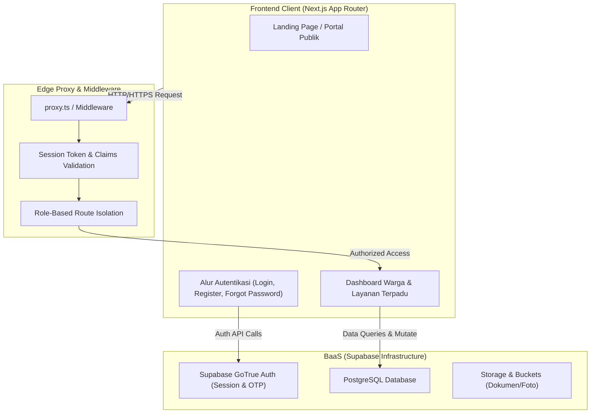
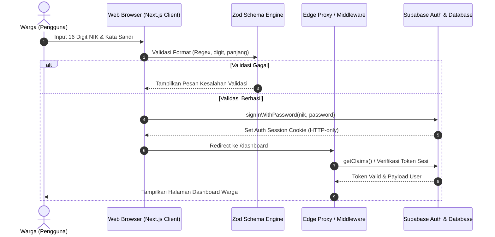

# 🏛️ GOV-HUB — Portal Layanan Publik Terpadu

> **"Satu NIK, Satu Akses untuk Berbagai Layanan Publik."**  
> Portal terpadu integrasi administrasi kependudukan (Dukcapil) dan verifikasi bantuan sosial ekonomi (Bansos & Desil) berbasis Single Identity Number (NIK).

---

## 👥 Informasi Tim & Pengembang

* **Nama Tim**: *[Nama Tim Anda]*
* **Daftar Anggota Tim**:
  1. **Agung Saputra** (231230003@unmuhpnk.ac.id) — Backend
  3. **Ferdian Iswara** (231230043@unmuhpnk.ac.id) — Frontend
  2. **Ade Tio Denari** (231230031@unmuhpnk.ac.id) — Data Analyst + UI Designer
  3. **Muhmmad Borneo Satria Prawira Putra** (231230011@unmuhpnk.ac.id) — Data Analyst + UI Designer
  

---

## 📌 Deskripsi Produk & Analisis Masalah

### 1. Kategori Aplikasi
**Web Application** (Responsive Desktop & Mobile-first Web)

### 2. Masalah yang Diangkat
* **Fragmentasi Layanan Publik**: Warga harus mengakses portal dan loket fisik yang terpisah antara dinas kependudukan (Dukcapil) dan dinas sosial (Dinsos).
* **Redundansi Berkas & Data**: Masyarakat berulang kali mengunggah fotokopi KTP, KK, dan surat keterangan yang sama untuk setiap layanan publik yang berbeda.
* **Kurangnya Transparansi Status Permohonan**: Proses validasi berkas fisik sering kali memakan waktu lama tanpa ada kejelasan status pelacakan berkas secara real-time.

### 3. Solusi yang Diberikan
**GOV-HUB** mengintegrasikan verifikasi identitas berbasis Single Identity Number (**NIK**) dengan session handling terpusat:
* **Single Sign-On (SSO) Kependudukan**: Warga cukup masuk sekali menggunakan NIK dan kata sandi untuk mengakses seluruh modul dinas.
* **Dashboard Terpadu**: Pemantauan status kependudukan (NIK aktif, KK terdaftar, sinkronisasi keluarga) serta integrasi akses instan ke Layanan Dukcapil & Bansos.
* **Alur Pemulihan & Pendaftaran Mandiri**: Fitur registrasi dengan validasi Zod ketat serta mekanisme pemulihan kata sandi bertahap melalui verifikasi kode OTP email.

### 4. Target Pengguna
1. **Warga Negara / Masyarakat Umum**: Mengajukan pembaruan KTP-el, pemutakhiran data keluarga, dan cek status kelayakan bansos/desil.
2. **Petugas Verifikator Dinas (Dukcapil & Dinsos)**: Melakukan validasi berkas dan konfirmasi jadwal biometrik secara terisolasi sesuai wewenang instansi.
3. **Administrator Sistem**: Mengelola kuota antrean, ketersediaan blangko, dan keamanan platform.

---

## 🌟 Daftar Fitur Utama yang Telah Diimplementasikan

- [x] **Autentikasi & Autorisasi Terpusat**:
  - Login berbasis NIK (16 digit) dan kata sandi dengan integrasi Supabase Auth SSR.
  - Registrasi akun warga dengan validasi keamanan kata sandi (Zod schema: huruf kapital, angka, minimal 8 karakter).
  - Alur *Forgot Password* bertahap: Input identitas &rarr; Verifikasi 5 digit OTP &rarr; Reset kata sandi baru &rarr; Notifikasi berhasil.
- [x] **Dashboard Interaktif Warga**:
  - Masking privasi NIK otomatis (`NIK:**********123`).
  - Indikator status data kependudukan terverifikasi (NIK aktif, KK terdaftar, keluarga sinkron).
  - Portal navigasi cepat ke modul **Layanan KTP & Dukcapil** dan **Layanan Desil & Bansos**.
- [x] **Antarmuka Responsif & Desain Bertema Nasional**:
  - Responsif penuh untuk semua resolusi (Mobile, Tablet, Desktop).
  - Peta spasial interaktif SVG kepulauan Indonesia pada Landing Page.
  - Animasi transisi halus (*micro-interactions*) menggunakan Motion.
  - Dukungan mode tema (*Dark Mode* / *Light Mode*) melalui `next-themes`.

---

## 🛠️ Arsitektur Teknologi (Tech Stack)

| Kategori | Teknologi | Keterangan / Penggunaan |
| :--- | :--- | :--- |
| **Framework** | [Next.js](https://nextjs.org/) (v15+ App Router, React 19) | Server-Side Rendering (SSR), Server Components, dan Route Handlers |
| **Bahasa Pemrograman** | [TypeScript](https://www.typescriptlang.org/) (v5) | Type-safe development di seluruh modul aplikasi |
| **Styling & Design System** | [Tailwind CSS](https://tailwindcss.com/) & [shadcn/ui](https://ui.shadcn.com/) | Utilitas styling modular, Radix UI primitives, responsivitas multi-device |
| **Animasi & Interaksi** | [Motion](https://motion.dev/) & [Lucide React](https://lucide.dev/) | Animasi scroll-triggered & pustaka ikon vektor |
| **Validasi Skema** | [Zod](https://zod.dev/) | Validasi form input NIK, email, no handphone, dan kekuatan password |
| **Backend & Autentikasi** | [Supabase](https://supabase.com/) | Auth SSR, PostgreSQL database, RLS (Row Level Security), session management |
| **State & Theme** | `next-themes` | Manajemen tema Light / Dark mode |

---

## 🏛️ Diagram Arsitektur Sistem & Alur Data

### 1. Arsitektur Tingkat Tinggi (High-Level Architecture)



### 2. Alur Data Autentikasi Warga (Authentication Flow)



---

## ⚙️ Panduan Instalasi & Menjalankan Aplikasi


### 1. Prasyarat Sistem
* [Node.js](https://nodejs.org/) versi 18.18.0 atau lebih baru (disarankan Node v20 LTS).
* Manajer paket: `npm`, `pnpm`, atau `yarn`.
* Akun dan proyek aktif di [Supabase](https://supabase.com/).

### 2. Langkah Kloning & Instalasi

```bash
# 1. Kloning repositori proyek
git clone https://github.com/Dream23978/GOV-HUB.git
cd gov

# 2. Instal seluruh dependensi proyek
npm install
```

### 3. Konfigurasi Variabel Lingkungan (.env)

Salin berkas contoh konfigurasi `.env.example`:

```bash
cp .env.example .env.local
```

Lengkapi kredensial Supabase Anda di dalam `.env.local`:

```env
# URL Project Supabase
NEXT_PUBLIC_SUPABASE_URL=https://<your-project-ref>.supabase.co

# Anon/Publishable API Key dari Supabase Project Settings > API
NEXT_PUBLIC_SUPABASE_PUBLISHABLE_KEY=sb_publishable_<your-key>

# (Opsional jika menggunakan penamaan variabel anon lama)
NEXT_PUBLIC_SUPABASE_ANON_KEY=<your-anon-key>
```

### 4. Menjalankan Server Pengembangan

```bash
npm run dev
```
Buka peramban Anda di [http://localhost:3000](http://localhost:3000).

### 5. Build untuk Lingkungan Produksi

```bash
npm run build
npm run start
```

---

## 🔑 Akun Demonstrasi (Demo Credentials)

Untuk pengujian fitur login dan peninjauan dashboard warga, silakan gunakan akun demo berikut:

| Peran Akun | Kredensial / NIK | Kata Sandi | Tujuan Pengujian |
| :--- | :--- | :--- | :--- |
| **Warga (Demo)** | `3201012304950001` *(atau NIK demo terdaftar)* | `Demo1234#` | Akses Dashboard Warga & Navigasi Layanan |
| **Registrasi Baru** | Input sembarang 16 digit NIK baru | Sesuai aturan form | Pengujian validasi pendaftaran akun baru |

> **Catatan Penguji:** Pada alur login demo, sistem memetakan NIK ke format identitas internal untuk otentikasi Supabase. Pastikan database Supabase Anda telah dikonfigurasi dengan akun terkait atau gunakan menu **Daftar Akun** terlebih dahulu.

---

## 🤖 Dokumentasi Penggunaan AI

Sesuai dengan ketentuan transparansi pengembangan:

* **Layanan & Model AI yang Digunakan**:
  * **Google Gemini 4 Argon (High)** melalui asisten pengembang Antigravity AI.
* **Bagian Produk & Proses yang Memanfaatkan AI**:
  * **Analisis Kode & Refactoring Komponen UI**: Membantu penyusunan komponen form Zod, masking NIK, serta sinkronisasi tema Tailwind CSS.
  * **Penyusunan Dokumentasi & Diagram Mermaid**: Merancang visualisasi arsitektur sistem, alur otentikasi data, dan penyusunan berkas `README.md` berstandar kompetisi.
  * **Implementasi Validasi Skema**: Perumusan validasi regex NIK (16 digit), nomor handphone, dan kekuatan kata sandi.

---

## 📚 Atribusi Template, Aset, & Pihak Ketiga

1. **Framework & Boilerplate**:
   * Starter Kit resmi [Next.js & Supabase Template](https://github.com/vercel/next.js/tree/canary/examples/with-supabase) oleh Tim Vercel & Supabase.
2. **Komponen Antarmuka (UI Components)**:
   * [shadcn/ui](https://ui.shadcn.com/) dibuat oleh [shadcn](https://twitter.com/shadcn) (Lisensi MIT).
   * [Radix UI Primitives](https://www.radix-ui.com/) oleh WorkOS (Lisensi MIT).
3. **Ikonografi & Visual**:
   * [Lucide React](https://lucide.dev/) (Lisensi ISC / MIT).
   * Lambang Garuda Pancasila & Logo Resmi: Domain Publik Indonesia / Aset Pemerintahan.
   * Ilustrasi & Banner Dashboard: Aset visual kustom instansi publik.
4. **Pustaka Animasi**:
   * [Motion](https://motion.dev/) (sebelumnya Framer Motion) oleh Motion Software Ltd.
